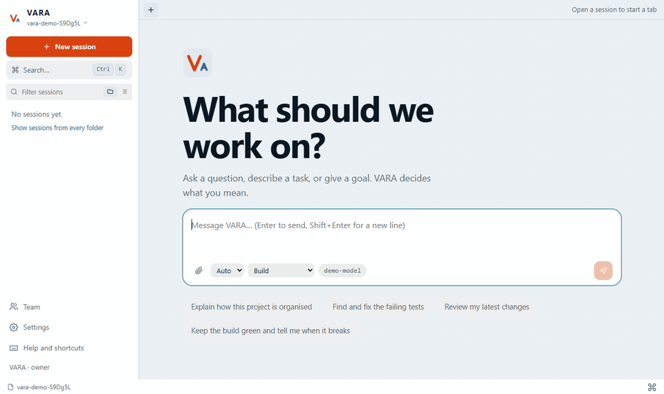

# VARA

[English](README.md) · **العربية**

وكيل برمجة في الطرفية وفي المتصفح يعمل بمفتاح **مزوّدك أنت**. يؤدي عمل الأدوات المدفوعة بفاتورة أصغر بكثير، لأن كل ما يُرسَل إلى النموذج يمرّ على محرّك لتوفير التكلفة. تعطيه رسالة، فيفهم هل هي دردشة أو سؤال أو مهمة أو هدف مستمر، ثم يعمل ويُثبت النتيجة بأدلة مسجّلة — لا بادّعاء النموذج.

```
vara            # واجهة الطرفية: شاشة البداية، اكتب أي شيء أو افتح جلسة سابقة
vara ui         # الوكيل نفسه في المتصفح
vara setup      # أضف مزوّداً، الصق المفتاح، اسحب النماذج واختبرها
```

---

## كيف يبدو

<p align="center"></p>

<p align="center"></p>

<p align="center"></p>

<p align="center"></p>

<p align="center"> </p>

هذه هي الواجهة الحقيقية، أنتجها [scripts/capture-screens.ts](scripts/capture-screens.ts). والنموذج فيها **سيناريو مكتوب** (بلا مزوّد ولا مفتاح)، فهي تُري الواجهة ولوحة الأدلة لا ذكاء أي نموذج.

---

## لماذا VARA

| | |
| --- | --- |
| **يفهم ما تريد** | كل رسالة تُصنَّف: `chat` (يُجاب بلا أدوات) · `question` (يقرأ المشروع ويجيب) · `task` (يعمل ويُثبت) · `goal` (يستمر). عند الشك يختار الأضعف صلاحية، فلن يغيّر ملفاتك بسبب تخمين. وللنموذج أن يرفع النيّة بأداة `escalate`. |
| **فاتورة أصغر** | كاش المزوّد، ضغط مخرجات الأدوات القديمة، عدم إعادة قراءة ملف لم يتغيّر، نموذج أرخص للدردشة والأسئلة والوكلاء الفرعيين، تفكير فقط للعمل الحقيقي. `/cost` يعرض ما وُفِّر. **v2:** موجِّه نماذج بحدّ جودة تضعه أنت، وضغط المخرجات الطويلة، وخريطة مستودع، وملخصات للأدوار القديمة، وعدّاد حد بوتيرته («يدوم N ساعة») وتقرير توفير — مقيس بلا اتصال في [docs/ar/COST.md](docs/ar/COST.md)؛ و`vara eval` يقارن ON وOFF على 19 مهمة برمجية في الجودة **و**التكلفة ([docs/ar/EVAL.md](docs/ar/EVAL.md) — لم يُشغَّل سوى الوضع بلا اتصال؛ لا نتيجة على مزوّد حقيقي منشورة بعد). |
| **أي مزوّد** | OpenAI · Anthropic · OpenRouter · DeepSeek · Groq · Gemini · Mistral · xAI · Together · Ollama · LM Studio · أي عنوان مخصّص متوافق مع OpenAI أو Anthropic. لكل نموذج حالة مختبَرة (يعمل / فشل / لم يُختبر) ونافذة سياق قابلة للتعديل. |
| **سرب وكلاء فرعيين** | أداة `delegate` تشغّل حتى 4 وكلاء (3 في وقت واحد) بأدوار مسمّاة (باحث، مراجع، منفّذ، مختبِر) وقائمة مهام مشتركة واعتماديات وميزانية استدعاءات/تكلفة وحالة حيّة في المتصفح — وتعيد تقريراً واحداً مدموجاً. |
| **أوضاعك الخاصة** | إلى جانب plan/build: أوضاع مسمّاة بقوائم سماح ومنع للأدوات والأوامر. الوضع يضيّق plan أو build فقط ولا يوسّعهما أبداً. |
| **الوكيل يدير نفسه — بموافقتك** | يستطيع كتابة مهارة أو إضافة/تبديل خادم MCP أو تغيير الوضع، لكن كل تغيير بطاقة موافقة عليك السماح بها؛ ويمكن إيقاف المهارات والخوادم لكل جلسة. |
| **MCP** | اربط أي خادم Model Context Protocol (أمر محلي أو رابط بعيد). أدواته تصل للوكيل مباشرة، وما كان منها للقراءة فقط يعمل حتى في وضع PLAN. |
| **المهارات** | أدلة عمل `SKILL.md` يحمّلها الوكيل عند الحاجة. 5 مدمجة (`code-review` و`debug` و`write-tests` و`explain-code` و`git-commit`)، وتضيف مهاراتك لكل المشاريع أو لمشروع واحد. |
| **تفكير قابل للتحكم** | يكتشف VARA أي النماذج تدعم التفكير الممتد / جهد الاستدلال ويعرض لك المستويات التي يدعمها النموذج فقط. |
| **إثبات لا ادّعاء** | الإنهاء يمرّ على تحقق مستقل يشغّله **المحرّك** (أمر التحقق + حالة git). فشله يعني أن العمل لم يكتمل. |
| **المتصفح وسطح المكتب** | يستطيع الوكيل قيادة متصفح معزول (أداة `browser`) ورؤية شاشتك والتحكم بها إن سمحت (أداة `desktop`). كلاهما متوقف افتراضياً، ويسأل قبل الخطوات الخطرة، ولا يكتب كلمات المرور أبداً، ولأداة سطح المكتب مفتاح إيقاف. |
| **الموصّلات** | GitHub وNotion وSentry وSupabase وغيرها بنقرة كخوادم MCP جاهزة، ورموزها في الخزنة المشفّرة. |
| **بحث في الويب من جهازك** | `web_search` و`web_fetch` يبحثان في الإنترنت بلا API مدفوع: DuckDuckGo من اتصالك أنت أولاً، ثم متصفحك الحقيقي إن سمحت، ومفاتيح Brave/Tavily/Serper اختيارية. النتائج تُعامل كنص غير موثوق. انظر [docs/ar/WEB-SEARCH.md](docs/ar/WEB-SEARCH.md). |
| **يتذكر ويكرر ويتعلم** | ملاحظات تبقى بين الجلسات (`/memory`)، ومهارات **يقترحها** الوكيل وتوافق عليها أنت، ومهام مجدولة (`vara schedule`). كلها معطّلة افتراضياً. |
| **جلسات طويلة تبقى رخيصة** | `/compact [ما يُحتفظ به]` يطوي الأدوار القديمة في ملخص عند الطلب، والضغط التلقائي يفعله وحده قرب حد النافذة (`/autocompact`). |
| **أشِر إلى ما تريد** | `/اسم-المهارة` يشغّل مهارة؛ و`@مهارة` و`@خادم-mcp` و`@agents` (وكلاء فرعيون متوازون) و`@web` و`@browser` تخبر الوكيل بما يستعمل. يكملها Tab في الطرفية، وللمتصفح القوائم نفسها. |
| **سجّل الدخول بدل لصق التوكن** | تسجيل دخول OAuth للموصّلات البعيدة (GitHub وNotion وSentry وSupabase) والتوكنات تذهب مباشرة إلى الخزنة. لم يُجرَّب إلا على خادم اختبار محلي — [docs/ar/OAUTH.md](docs/ar/OAUTH.md) يذكر ما تفعله أنت بنفسك بالضبط. |
| **قابل للوصول من هاتفك** | `vara ui --public` على خادم يطبع رابطاً يعمل من أي مكان، و`vara ui` يسألك كيف تريد الوصول. تطبيق هاتف أصلي لم يُبنَ بعد؛ واجهة المتصفح تعمل على الهاتف. |
| **من هاتفك عبر Telegram** | معطّل افتراضياً: محادثة خاصة واحدة مقترنة، وردود عند انتهاء الدور، وأزرار موافقة/رفض لكل ما فيه خطر. انظر [docs/ar/GATEWAY.md](docs/ar/GATEWAY.md)؛ لم يُجرَّب بعد على خدمة Telegram الحقيقية. |
| **الأمان** | الصلاحيات مفروضة داخل الأدوات لا في الطلب · مخزن أسرار مشفّر · كل مخرج يُمسح منه أي سر · التكلفة غير المعروفة `null` لا صفر. |
| **مشاركة جلسة** | ادعُ أشخاصاً برابط أو QR إلى مضيفك بالصلاحيات التي تحددها، وراقب ما يستهلكون. مفاتيحك لا تغادر جهازك. |

---

## التثبيت (دقيقة واحدة، بلا Node ولا npm)

كل حزمة تحمل بيئة Node.js خاصة بها، فلا تحتاج تثبيت شيء قبلها.

**Windows** (PowerShell):

```powershell
irm https://raw.githubusercontent.com/VARA-TEAM/vara-cli/main/install.ps1 | iex
```

**macOS (Apple Silicon) وLinux (x64):**

```bash
curl -fsSL https://raw.githubusercontent.com/VARA-TEAM/vara-cli/main/install.sh | sh
```

ثم افتح نافذة طرفية جديدة:

```bash
vara setup     # مزوّد + مفتاح + نموذج
vara           # ابدأ
vara doctor    # يتحقق أن كل شيء يعمل
```

المثبّت يتحقق من بصمة SHA-256 للتنزيل قبل تشغيل أي شيء، ولا يحتاج صلاحيات مدير. للتحديث أعد تشغيل الأمر نفسه.

التحميل اليدوي من صفحة [Releases](https://github.com/VARA-TEAM/vara-cli/releases): `vara-win-x64.zip` و`vara-macos-arm64.tar.gz` و`vara-linux-x64.tar.gz` مع `SHA256SUMS.txt`. لم تُنشر بعد حزم macOS على Intel ولا ARM على Windows/Linux — استعمل التثبيت من المصدر أدناه.

**الإزالة:** احذف `%LOCALAPPDATA%\vara` (Windows، واحذفه أيضاً من PATH الخاص بمستخدمك) أو `~/.local/share/vara` و`~/.local/bin/vara` (macOS/Linux). بياناتك في `~/.vara` منفصلة وتبقى حتى تحذفها.

خيارات المثبّت (macOS/Linux): `VARA_INSTALL_DIR` (الافتراضي `~/.local/share/vara`) و`VARA_BIN_DIR` (الافتراضي `~/.local/bin`).

## من المصدر (للمطوّرين)

```bash
git clone https://github.com/VARA-TEAM/vara-cli.git
cd vara-cli
npm install
npm run build
npm link            # يوفّر الأمر `vara`
vara setup
vara
```

بعد أي `git pull` أعد `npm run build` — الأمر `vara` يشغّل `dist/`. أثناء التطوير: `npm run dev` يشغّل من المصدر مباشرة.

المتطلبات: Node ≥ 20. اختياري: `rg` (ripgrep) لبحث أسرع — بدونه يُستعمل محرّك مدمج؛ `npx` / `uvx` لخوادم MCP؛ و`git` لعرض الفروقات والـ commits.

---

## في الطرفية

اكتب رسالتك مباشرة. للأوامر اضغط `Ctrl+K` أو اكتب `/`.

| الأمر | الوظيفة |
| --- | --- |
| `/providers` · `/models` · `/model [id]` · `/provider <name> [model]` | المزوّدون والنماذج. داخل شاشاتها: `t` اختبار نموذج · `a` اختبار الكل · `r` سحب قائمة النماذج · `c` تعديل السياق · `h` مستوى التفكير · `k` تعيين المفتاح · `n` إضافة نموذج · `x` حذف نموذج · `d` حذف مزوّد |
| `/think [off\|low\|medium\|high]` | مستوى التفكير للنموذج الحالي إن دعمه |
| `/mcp` | خوادم MCP: إضافة من قائمة جاهزة (filesystem وfetch وmemory وplaywright وgithub وcontext7) أو أي أمر / رابط |
| `/skills` · `/skills new <name>` · `/skills proposals\|show\|approve\|reject` · `/skill <name> [about]` · `/<skill-name> [about]` | المهارات (وما اقترحه الوكيل) |
| `/memory [add\|edit\|remove\|on\|off]` | ملاحظات تبقى بين الجلسات ([docs/ar/AUTOMATION.md](docs/ar/AUTOMATION.md)) |
| `/enable <name>` · `/disable <name>` | تشغيل/إيقاف مهارة أو خادم MCP لهذه الجلسة فقط |
| `/approve` · `/deny` | الجواب على تغيير طلب الوكيل إجراءه على نفسه |
| `/settings` (`Ctrl+O`) | الثيم، اللوحة الجانبية وأقسامها، فهم النيّة، الوضع الافتراضي، أمر التحقق، النموذج الأرخص، النشر، ميزانيات المهمة والهدف، السياق، المهارات |
| `/theme <name>` | 9 ثيمات تُطبَّق فوراً |
| `/cost` | الإنفاق والتوفير: الكاش، الضغط، القراءات المكررة، النموذج الأرخص، الوكلاء الفرعيون |
| `/limit` | حدّك: `5000000 tokens per 5h` أو `$20 per month` أو `percent 37` أو `eco on`؛ ويعرض كم يدوم |
| `/savings` | ما وفّره VARA (هذه الجلسة، 7 أيام، كل الوقت) مع طريقة الحساب |
| `/route` | أي نموذج لأي دور، وحدّ الجودة الذي حددته |
| `/context` · `/status` · `/evidence` · `/last` | نافذة السياق · الميزانية والتقدم · الأدلة المسجّلة · المخرج الكامل لآخر أداة |
| `/export [file]` | حفظ المحادثة كملف markdown |
| `/new` (`Ctrl+N`) · `/sessions [--all]` · `/resume <id>` | الجلسات — تبويبات، وشاشة البداية لا تطلب منك شيئاً |
| `/mode plan\|build\|<وضعك>` · `/kind auto\|task\|goal` · `/pause` · `/stop` · `/quit` · `/help` | |

في أي رسالة: `@src/app.ts` يُرفق الملف (داخل مجلد العمل فقط، حتى 120KB، وبحد أقصى 6 ملفات للرسالة).

**المفاتيح:** `Enter` إرسال · `Ctrl+J` سطر جديد · `Tab` PLAN/BUILD · `Ctrl+N` جلسة جديدة · `Ctrl+K` الأوامر · `Ctrl+O` الإعدادات · `Ctrl+B` اللوحة الجانبية · `Ctrl+W` إغلاق التبويب · `Alt+←/→` التنقل بين التبويبات · عجلة الماوس أو `↑↓` للتمرير (`PgUp/PgDn` أسرع) · `Ctrl+G` إلى آخر المحادثة · `Esc Esc` قطع الوكيل · `Ctrl+C` حفظ وخروج.

## سطر الأوامر

| الأمر | الوظيفة |
| --- | --- |
| `vara` · `vara -c` | فتح الأداة · إكمال آخر جلسة في هذا المجلد |
| `vara resume <id>` · `vara sessions [--all]` | استئناف جلسة محفوظة · عرض الجلسات (هذا المجلد أو كلها) |
| `vara setup` · `vara providers` | إعداد المزوّدين · عرض حالتهم |
| `vara run "<مهمة>" [--goal] [--plan] [--cwd dir] [--verify "npm test"] [--publish] [--provider p] [--model m]` | تنفيذ بلا واجهة مع طباعة الأحداث |
| `vara ui` · `vara serve` | واجهة المتصفح · تشغيل VARA كخدمة بلا واجهة (VPS وDocker وCI) — انظر [docs/ar/DEPLOYMENT.md](docs/ar/DEPLOYMENT.md) |
| `vara ui --share` | رابط **عام** مؤقت عبر `cloudflared` أو `ssh` — انظر أدناه |
| `vara update [--check] [--rollback]` | تحديث هذا التثبيت من آخر إصدار (مع التحقق من SHA-256) · الرجوع |
| `vara invite` · `vara guests` | دعوة شخص · عرض الضيوف وسحب وصولهم |
| `vara secret set\|list\|delete <NAME>` | المخزن المشفّر |
| `vara config init\|show` | كتابة الإعدادات الافتراضية · عرضها (الأسرار لا تُعرض أبداً) |
| `vara connectors [list\|add <id>\|remove <id>]` | موصّلات جاهزة (GitHub وNotion وSentry وSupabase…)؛ والرموز تذهب إلى الخزنة |
| `vara eval --offline` · `vara eval --provider <name> --yes` | قياس محرك التكلفة ON مقابل OFF على مهام برمجية صغيرة: نسبة النجاح والرموز والتكلفة والزمن ← تقرير JSON وMarkdown ([docs/ar/EVAL.md](docs/ar/EVAL.md)) |
| `vara memory [list\|add\|edit\|remove]` · `vara skills [proposals\|show\|approve\|reject]` | ملاحظات الذاكرة · مهارات اقترحها الوكيل (معطَّلة حتى التفعيل؛ ولا يُثبَّت شيء قبل موافقتك) |
| `vara schedule [enable\|add\|list\|run\|logs\|tick\|daemon…]` | تشغيل متكرر بلا واجهة بفاصل أو صيغة cron — معطَّل افتراضيًا، قراءة فقط ما لم تضف `--build`، للمالك المحلي فقط |
| `vara doctor [--server]` · `vara --version` | فحص التثبيت (`--server`: وإعداد الخدمة أيضاً) · طباعة الإصدار |

المتغيّر `VARA_HOME` يغيّر مجلد البيانات (الافتراضي `~/.vara`).

---

## في المتصفح

```bash
vara ui                                         # يفتح الواجهة؛ لا يصل إليها إلا هذا الجهاز
vara ui --lan                                   # يسمح لأجهزة شبكتك بالانضمام
vara invite --preset collaborator --label Sam   # رابط دعوة بالصلاحيات التي تحددها
vara guests                                     # من دخل وماذا يستهلك · vara guests revoke <id>
```

**الملفات والصور والتطبيق الجاري**

- **الإرفاق:** اسحب ملفاً إلى مربع الرسالة، أو الصق لقطة شاشة، أو اضغط المشبك (الطرفية: `/attach <ملف>` أو `@المسار` أو السحب إلى الطرفية). تُرسَل الصور كصور إلى النماذج التي ترى (وإلا يُخبَر الوكيل فقط بأن صورة أُرفقت)؛ والملفات النصية حتى 120 ك.ب وملفات PDF (النص فقط) تُرفق كنص. 6 ملفات في الرسالة وحجم الصورة حتى 5 م.ب.
- **معاينة حيّة:** اطلب من الوكيل تشغيل خادم التطوير (أو `/preview start npm run dev`)؛ يظهر التطبيق في تبويب *معاينة* في اللوحة السفلية. على الخادم أن يقرأ متغير `PORT`. للمالك وحده.
- **رابط عام:** `vara ui --share` (يحتاج `cloudflared` أو `ssh`؛ و`--share-via` و`--share-minutes N` و`--share-preset`). يطبع دعوة للقراءة فقط على عنوان عام ويُغلق عند انتهاء المدة أو إيقاف المضيف. **كل من يملك دعوة يصل إلى هذا المضيف من الإنترنت عبر مزوّد نفق خارجي. وضيف بصلاحية التنفيذ يشغّل أوامر على جهازك — أبقِ الضيوف على وضع الخطة إلا إن كنت تثق بهم تماماً.**

`vara ui` يفتح تطبيقاً كاملاً فيه كل ما في الطرفية:

- **المحادثة:** بث حيّ، ماركداون بجداول وكود، بطاقات للأدوات، قائمة الوكلاء الفرعيين، إرفاق `@ملف`، أوامر `/`، لوحة أوامر (`Ctrl K`)، ومسودة تُحفظ لكل جلسة.
- **منصّة عمل:** شريط جانبي وتبويبات جلسات (اسحب لإعادة الترتيب؛ وجلستان جنباً إلى جنب) ولوحة جانبية ولوحة سفلية، كلها بمقابض سحب تعمل بلوحة المفاتيح أيضاً (النقر المزدوج يعيد المقبض إلى حجمه الأصلي)؛ وأربعة تخطيطات جاهزة؛ وتُحفظ لكل متصفح. وعلى الهاتف تصير اللوحات أدراجاً.
- **اللوحة الجانبية (لكل جلسة):** *الإثبات* (المتطلبات والأدلة المسجّلة والحدود والسياق) · *التكلفة* (الإنفاق والرموز وما وفّره VARA ومقياس نافذة السياق) · *الوكلاء* (كل تشغيل للوكلاء الفرعيين حيّاً: الأدوار والحالة ومسار زمني لمن عمل متى ومن انتظر من، والاستدعاءات والتكلفة والتقارير، وإلغاء وكيل أو كلهم) · *الملفات* المتغيّرة · *الأدوات*. **اللوحة السفلية:** *المخرجات* (ما عمل وما عاد) و*المعاينة* و*الأحداث*. تصدير ماركداون، إيقاف مؤقت، إيقاف نهائي، تحويل بين مهمة وهدف.
- **الإعدادات (للمالك):** المزوّدون والمفاتيح وقوائم النماذج واختبارها والسياق ومستوى التفكير · سلوك الوكيل والميزانيات والسياق · المهارات (عرض وإنشاء وتحرير وإيقاف) · خوادم MCP · المظهر (9 ثيمات، عربي/إنجليزي مع RTL، تخطيط للجوال).
- **الفريق (للمالك):** دعوة برابط أو QR، تعديل صلاحيات الضيف أو سحبها، ومعرفة من يعمل وماذا يستهلك.

قوالب الدعوة: `viewer` (مشاهدة) · `participant` (مشاهدة + كتابة في جلستك المشتركة) · `collaborator` (+ جلسة مستقلة بجانبك). لكل ضيف: سقف قوة (`plan` للقراءة فقط أو `build`)، قفل النموذج أو قائمة نماذج، سقف لاستدعاءات النموذج أو التكلفة، وانتهاء. مفاتيحك وإعدادات المزوّد لا تُعرض للضيوف أبداً، والضيف بقوة `build` ينفّذ أوامر على **جهازك** — ادعُ من تثق به فقط. التفاصيل ونموذج التهديد في [docs/ar/ARCHITECTURE.md](docs/ar/ARCHITECTURE.md) §7.6.

---

## الوثائق

الإنجليزية هي الافتراضية، والنسخ العربية في `docs/ar/` وملفات `*.ar.md`.

| الوثيقة | متى |
| --- | --- |
| [docs/ar/ARCHITECTURE.md](docs/ar/ARCHITECTURE.md) | كيف يعمل كل شيء ولماذا |
| [docs/ar/DEPLOYMENT.md](docs/ar/DEPLOYMENT.md) | تشغيل VARA على حاسوب أو VPS أو Docker أو جهاز CI (systemd وcompose ووكيل TLS) |
| [docs/ar/EVAL.md](docs/ar/EVAL.md) | `vara eval`: هل يوفّر محرك التكلفة المال دون خفض الجودة — المنهج والنتائج وما لم يُقَس |
| [docs/ar/WEB-SEARCH.md](docs/ar/WEB-SEARCH.md) | بحث حيّ في الويب وقراءة الصفحات للوكيل: بلا واجهة مدفوعة، يعمل من جهازك، حدود الأمان، وما جرى التحقق منه |
| [docs/ar/HERMES-COMPARISON.md](docs/ar/HERMES-COMPARISON.md) | ما تعلّمناه من Hermes Agent: ما عند VARA وما ينقصه وترتيب سدّ الفجوات |
| [docs/ar/OAUTH.md](docs/ar/OAUTH.md) | تسجيل الدخول عبر المتصفح لموصّلات MCP البعيدة (GitHub وNotion وSentry وSupabase) — ما يفعله VARA وما عليك إعداده بنفسك |
| [docs/ar/DEVELOPMENT.md](docs/ar/DEVELOPMENT.md) | تعديل الكود بأمان، وفخاخ معروفة |
| [docs/ar/ROADMAP.md](docs/ar/ROADMAP.md) | ما هو مفتوح وما تُرك عمداً |
| [CONTRIBUTING.ar.md](CONTRIBUTING.ar.md) | قبل أول commit |
| [CHANGELOG.ar.md](CHANGELOG.ar.md) | ما تغيّر فعلاً |
| [THIRD_PARTY_NOTICES.ar.md](THIRD_PARTY_NOTICES.ar.md) | أفكار مأخوذة من مشاريع أخرى |

## الرخصة

[MIT](LICENSE) — استعمل VARA وعدّله ووزّعه ودمجه في عملك، تجارياً أو غير تجاري. رخص المكتبات المضمَّنة في حزم الإصدار داخل `THIRD_PARTY_LICENSES.txt`.

## قواعد المشروع

1. **لا أسرار في المستودع** — المفاتيح في الخزنة المشفّرة أو متغيّرات البيئة، والإعدادات تحمل **أسماءها** فقط.
2. **`npm run check` أخضر قبل كل push** (typecheck + اختبارات + build). الفشل يُبلَّغ كما هو.
3. **unknown ≠ 0** — القيمة غير المعروفة تبقى غير معروفة.
4. **الإثبات بالاختبار** — سلوك جديد أو إصلاح = اختبار يفشل قبله وينجح بعده.
5. **الصدق في الواجهة** — لا مؤشر نجاح بلا أدلة، ولا «تم» بلا تحقق.
